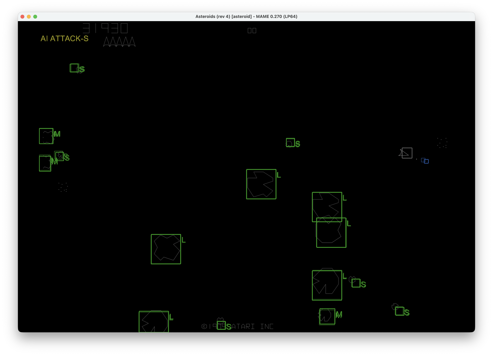
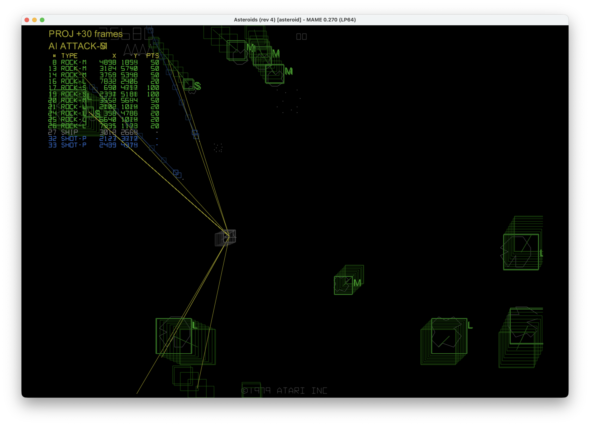
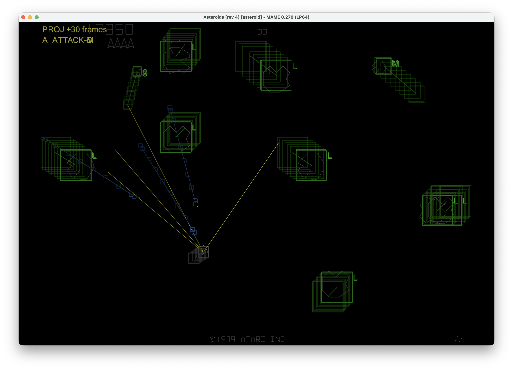
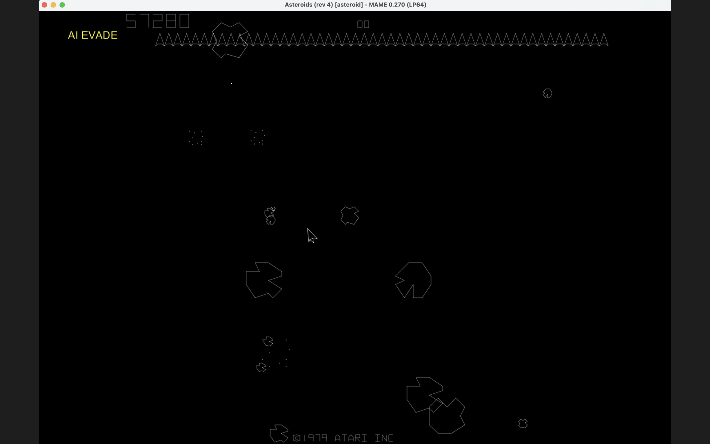
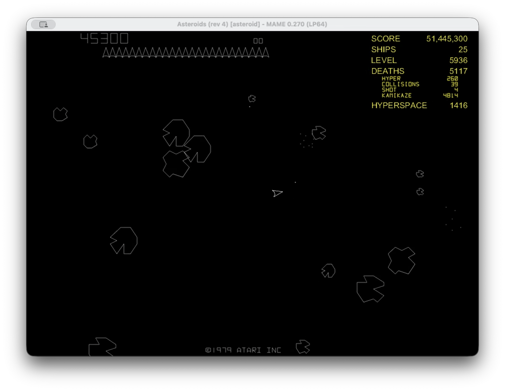

# Asteroids Automated Play in MAME

This project contains Lua and Python scripts that enable automated play of Atari's *Asteroids* (1979) inside MAME.

A Lua script running in MAME sends real-time game data to a local Python server via a socket. The server receives the game data and passes it off to a Python AI agent. The Python AI agent analyzes the game state and sends keypresses back to the Lua script to control gameplay. Information overlays showing what the AI sees can be toggled on and off.

Left unchecked, the autopilot will earn hundreds of thousands of points per ship lost. Asteroids draws the reserve ships each frame and, at about 150 reserve ships, the game slows down until a watchdog timer (emulated by MAME) resets the machine. Resetting the emulated machine under these conditions limits the achievable score to 1.7 million points. Losing ships when the reserve ship total is high keeps the game running at full speed. To maximize score, the autopilot chooses to keep the number of extra ships at or below 25, deliberately losing any ships beyond that number by ramming the current ship into a rock.

The score overlay breaks down how each ship was lost: failed hyperspace jumps, collisions with rocks or saucers, saucer shots, and "kamikaze" deaths. Kamikaze deaths are the ships the AI chose to lose on purpose.

## Tested with

- **MAME 0.270**
- **Asteroids (rev 4)**, MAME set `asteroid`
- **macOS 26.5.2** (Intel x86_64), **zsh 5.9** shell

It seems likely to work with other MAME versions, Asteroids ROM revisions, operating systems, and/or shells. Let me know how it goes. I struggled to find working examples of MAME Lua<>Python socket communication. The approach here works well and you are welcome to extend it as you like. I used Claude Code to help me clear the way.

## Files

| File            | Purpose                                                                                                 |
|-----------------|---------------------------------------------------------------------------------------------------------|
| `ast_link.lua`  | MAME autoboot Lua script                                                                                |
| `ast_server.py` | Python server. Handles local socket communication, decodes and tracks objects, and calls the autopilot  |
| `ast_ai.py`     | The autopilot: threat check, evasion, target choice and aiming                                          |
| `cfg/`          | MAME configuration for `asteroid`                                                                       |

## Requirements

- Python 3 with `numpy` (`pip3 install numpy`)
- Optional: `numba` (`pip3 install numba`). Depending on your development environment, numba can be installed to boost server speed. It compiles the autopilot's collision and aiming loops, making each frame's AI about 3x faster.
- A MAME build (tested with version 0.270)
- Asteroids (rev 4) ROM set, `asteroid.zip`, in `roms/`. You will have to find your own ROM set.
  **The ROMs are not included here.**

## Run

In a terminal window, start the Python server first:

```zsh
python3 ast_server.py
```

In a second terminal, start MAME:

```zsh
mame asteroid -rompath ../roms -window -autoboot_script ../ast_link.lua
```

Edit `-rompath ../roms` to match your configuration.

The Python autopilot inserts a coin, starts the game, and restarts it after each game ends.

### Python server (`ast_server.py`) options

In the arcade, each game of Asteroids starts from a random point. Since we are emulating Asteroids and running a bot, we would see the same game played each time. To add variety, a pseudo-randomized starting point is generated by default: when a game starts, a 15-bit seed is used for Asteroids' random-number generator (32,768 possible starting points). The session seed is printed when the server starts, and each game's starting value is logged as `game N start: RNG 0x....`. To replay a session, use the command line option `--random <N>`.

| Option         | Effect                                                               |
|----------------|----------------------------------------------------------------------|
| `--random on`  | Default. Seed from the system clocks, process ID and OS entropy      |
| `--random off` | Leave the game's generator alone (every run plays the same)          |
| `--random <N>` | Use seed N, e.g. one printed earlier, to replay that session exactly |

#### Play styles

`--style <name>` picks how the autopilot plays (`M` in MAME switches styles while running).

| Style     | Behavior                                                                                                    |
|-----------|-------------------------------------------------------------------------------------------------------------|
| `classic` | Default. Aims at the highest-priority target and fires; returns to the middle between waves. Most efficient |
| `flyer`   | Prefers to fly around more, choosing predicted-safe paths; returns to the middle between waves              |
| `shadow`  | Spares one large rock per level and flies close to it until 2 saucers are killed                            |

## Keys (in MAME)

| Key       | Action                                                              |
|-----------|---------------------------------------------------------------------|
| `I`       | Interrupt autopilot on/off (off = you play)                         |
| `B`       | Boxes around objects and aim line on/off                            |
| `O`       | Object list on/off                                                  |
| `V`       | View projected object positions on/off                              |
| `]` / `[` | Project further / less far ahead (5–300 frames, step 5)             |
| `A`       | AI state text on/off                                                |
| `S`       | Score overlay on/off; shows the full score past the 99,990 rollover |
| `.` / `,` | Faster / slower emulation (0.25x–8x, then MAX; default 1x)          |
| `=` / `-` | MAME volume up / down (2 dB steps)                                  |
| `M`       | Next play style (classic, flyer, shadow)                            |

## Object Detection Overlay Examples





## Video

<a href="https://youtu.be/11Aerj8sB8E?si=0yZIJSVTaihNBKK4"></a>

[One Hour of Automated Gameplay](https://youtu.be/11Aerj8sB8E?si=0yZIJSVTaihNBKK4)

<a href="https://youtu.be/zNzcSkk0HAY"></a>

[High Score Run 11 Hours 59 minutes](https://youtu.be/zNzcSkk0HAY)
